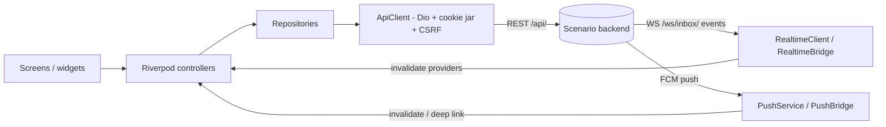

# Scenario Mobile

Flutter client for **Scenario**, an omnichannel customer-service platform. It is a second front end for the same Django backend the web app uses: same session-cookie authentication, same permissions, same visibility rules. The mobile app holds no business logic of its own and renders whatever the API returns.

- **Package name:** `scenario_mobile` (version `1.1.2+14`, see [`pubspec.yaml`](pubspec.yaml))
- **Application ID (Android):** `com.scenario.scenario_mobile`
- **Languages / UI:** English and Arabic (RTL supported)
- **Platforms with project folders:** Android, iOS

## Table of contents

- [Overview](#overview)
- [Key features](#key-features)
- [Screenshots and demo](#screenshots-and-demo)
- [Technology stack](#technology-stack)
- [Architecture](#architecture)
- [Project structure](#project-structure)
- [Prerequisites](#prerequisites)
- [Installation and setup](#installation-and-setup)
- [Running the app](#running-the-app)
- [Configuration](#configuration)
- [API and backend integration](#api-and-backend-integration)
- [Testing](#testing)
- [Build and release](#build-and-release)
- [Troubleshooting](#troubleshooting)
- [Security](#security)
- [Further documentation](#further-documentation)
- [Contributing](#contributing)
- [License](#license)
- [Contact and links](#contact-and-links)

## Overview

Scenario gives support teams one shared inbox across customer messaging channels (the API reference in [`API.md`](API.md) lists WhatsApp, Messenger, Instagram and TikTok), together with customer records, orders, routing, teams, and conversation intelligence (lead scoring, purchase detection).

This app is aimed at **employees of an organization using Scenario** (agents, supervisors, admins). It lets them answer conversations, manage customers and teams, review analytics, and receive notifications from a phone. What each person sees is decided by the backend according to their role and permissions.

## Key features

**Inbox and conversations** (`lib/features/conversations`, `lib/features/messages`)
- Conversation list with quick filters, platform/account filter, infinite scroll, pinning and unread badges
- Conversation thread with text, images, documents and voice notes (record and playback), quoted replies, swipe-to-reply, message copy/delete, retry on send failure and draft preservation
- Internal notes, assignment (self / manual), resolve with undo, conversation history, follow-up and review flows, conversion reporting
- Customer intelligence panel (lead score, etc.), saved replies picker, WhatsApp message templates

**Customers, orders and directory** (`lib/features/directory`, `lib/features/orders`, `lib/features/customer_fields`)
- Customer directory and profile, edit customer, custom customer fields and field-based filters, save to device contacts
- Orders and customer data sheets
- Employees and teams (list, create/edit/deactivate, working hours) subject to permissions
- CSV export for Customers and Inbox via the platform share sheet

**Dashboard and analytics** (`lib/features/dashboard`, `lib/features/analytics`)
- Role-scoped dashboard with date filter and in-memory result caching; analytics section for roles with `analytics.view`

**Settings** (`lib/features/settings`, `lib/features/saved_replies`, `lib/features/templates`)
- Profile, password, availability, appearance (theme mode and color theme), language
- Channel connection (OAuth URL opened in the system browser; the backend completes the callback)
- Saved replies with categories and attachments, templates, routing/workload settings

**Notifications and realtime**
- WebSocket signals while the app is in the foreground; Firebase Cloud Messaging push while backgrounded or closed
- In-app notifications screen with unread bell badge; push taps deep-link to the conversation

**Platform behaviour**
- Google Play in-app update prompt (Android only)
- Connectivity monitor with a startup connection screen and offline-at-launch retry
- Client error reporting to the backend (`lib/core/logging/client_error_reporter.dart`)

## Screenshots and demo

No screenshots or demo videos are present in the repository. Branding assets live in [`assets/`](assets).

## Technology stack

| Area | Technology |
| --- | --- |
| Framework | Flutter, Dart SDK `^3.12.0` |
| State management | `flutter_riverpod` 3 (`AsyncNotifier`, `Notifier`, providers) |
| Routing | `go_router` (auth-aware redirects, deep links) |
| HTTP | `dio`, `cookie_jar` / `dio_cookie_manager` (persistent session cookie) |
| Realtime | `web_socket_channel` (Django Channels JSON socket) |
| Push | `firebase_core`, `firebase_messaging` |
| Secure storage | `flutter_secure_storage` (Keychain / EncryptedSharedPreferences) |
| Media and files | `image_picker`, `file_picker`, `record`, `audioplayers`, `open_filex`, `mime`, `path_provider` |
| Other | `share_plus`, `url_launcher`, `connectivity_plus`, `cached_network_image`, `flutter_contacts`, `in_app_update`, `intl` |
| Localization | ARB files + `flutter gen-l10n` (`l10n.yaml`), Cairo font bundled |
| Testing | `flutter_test`, `mocktail`, `fake_async` |
| Android build | AGP 9.0.1, Kotlin 2.3.20, Gradle 9.1.0, Java 17, `compileSdk` 37 |
| Backend (external) | Django REST Framework + Django Channels at `scenariomnchnl.tech` (separate repository, not included here) |

## Architecture

Server-authoritative thin client:

- **Authentication** reuses the web session cookie (`scenario_session`) and CSRF cookie/header; no bearer tokens.
- **REST is the source of truth.** WebSocket events (e.g. `message.created`, `conversation.assigned`, `notification.created`) and FCM pushes are *invalidation signals*: the app refetches from REST rather than patching local state from payloads.
- **Navigation is declared once** in `lib/app/navigation.dart`; both the drawer and the router guard read it, so a link is never shown for a section the role cannot open. This is presentation only; the backend re-checks every capability.
- **State** lives in Riverpod providers/controllers per feature; repositories wrap `ApiClient`. Providers are overridable in tests.



Related cross-cutting pieces: a session epoch (`lib/core/session`) prevents responses from an older session ending a newer one; a single hook turns any 401 (or 403 `not_authenticated`) into a return to the login screen; an in-memory `QueryCache` (`lib/core/cache`) de-duplicates dashboard/analytics requests.

## Project structure

```text
.
├── lib/
│   ├── main.dart                 # Entry point, crash hooks, ProviderScope, app shell
│   ├── app/                      # router.dart (go_router), navigation.dart (role-based sections)
│   ├── core/
│   │   ├── api/                  # ApiClient (Dio), typed ApiException
│   │   ├── auth/                 # AuthRepository
│   │   ├── cache/                # QueryCache, cached async values
│   │   ├── config/               # Environment (backend host/TLS), dev TLS override
│   │   ├── logging/              # AppLog, client error reporter
│   │   ├── models/               # API models
│   │   ├── network/              # Connectivity monitor
│   │   ├── notifications/        # FCM service, device registration, push bridge
│   │   ├── preferences/          # Theme / locale preferences
│   │   ├── realtime/             # WebSocket client and bridge
│   │   ├── session/              # Session epoch and reset
│   │   ├── storage/              # SecureStore
│   │   ├── theme/ utils/ widgets/ update/
│   ├── features/                 # One folder per feature area (analytics, authentication,
│   │                             #   conversations, customers, customer_fields, dashboard,
│   │                             #   directory, messages, notifications, orders, performance,
│   │                             #   saved_replies, settings, splash, startup, templates)
│   └── l10n/                     # app_en.arb, app_ar.arb, generated/ (committed)
├── test/                         # 133 test files + support/ helpers
├── android/ ios/                 # Platform projects
├── assets/                       # Fonts (Cairo), images, launcher and splash artwork
├── docs/                         # MOBILE_BACKEND_SYNC.md, api/openapi.yaml
├── legal/                        # Static privacy policy / terms / data-deletion site
├── .github/workflows/android.yml # CI
└── API.md, SECURITY.md, CODEBASE_AUDIT.md, NOTIFICATIONS_*.md, scenario_directory_management_spec.md
```

## Prerequisites

- **Flutter** (stable channel) whose bundled Dart satisfies `^3.12.0`. CI uses `subosito/flutter-action` on the `stable` channel.
- **JDK 17** (used by CI and set in `android/app/build.gradle.kts`).
- **Android SDK** with platform `android-37.0` (the Gradle build targets `compileSdk = 37`, `compileSdkMinor = 0`).
- **Xcode and CocoaPods** for iOS builds (macOS only).
- **A reachable Scenario backend** (default development host `scenariomnchnl.tech`, or your own).
- **A Firebase project** only if you need push notifications (optional; see below).

## Installation and setup

```bash
git clone https://github.com/indoo24/SocialOmniChannelMobileApp.git
cd SocialOmniChannelMobileApp
flutter pub get
```

Localization output is committed in `lib/l10n/generated/`. If you edit the `.arb` files, regenerate it with `flutter gen-l10n` (also run automatically by `flutter pub get`/builds because `generate: true` is set).

### Push notifications (optional)

Push is enabled only when Firebase config files are present; otherwise the app builds and runs with push silently disabled.

- Android: place your `google-services.json` at `android/app/google-services.json` (the Google Services Gradle plugin is applied only if this file exists).
- iOS: add your `GoogleService-Info.plist` to the `Runner` target in Xcode. Push also requires the Push Notifications capability and APNs key set up in Firebase. This setup is not committed in the repo and needs confirmation for your Apple account.

Neither file is in the repository; do not commit yours to a public repo without reviewing your policy. See [`NOTIFICATIONS_MOBILE.md`](NOTIFICATIONS_MOBILE.md) for the push design.

## Running the app

```bash
# Default: development environment, host scenariomnchnl.tech over HTTPS/WSS
flutter run

# Against a local backend from an Android emulator (host machine is 10.0.2.2)
flutter run \
  --dart-define=SCENARIO_ENV=development \
  --dart-define=SCENARIO_API_HOST=10.0.2.2:8000 \
  --dart-define=SCENARIO_USE_TLS=false
```

Cleartext (`SCENARIO_USE_TLS=false`) works only in debug/profile builds; release builds always use TLS. See `lib/core/config/environment.dart`.

## Configuration

There is no `.env` file. Configuration is passed with `--dart-define` at run/build time ([`lib/core/config/environment.dart`](lib/core/config/environment.dart)):

| Variable | Required | Default | Purpose |
| --- | --- | --- | --- |
| `SCENARIO_ENV` | No | `development` | `development` or `production`. Selects the backend, not the trust level. |
| `SCENARIO_API_HOST` | **Yes for `production`** | `scenariomnchnl.tech` in development; empty in production | Host (and optional port) only, no scheme or trailing slash. An empty production host makes startup fail with a "misconfigured" screen. |
| `SCENARIO_USE_TLS` | No | `true` | Use `https`/`wss`. Forced to `true` in release builds and in production. |

Derived URLs: REST base `https://<host>/api`, realtime `wss://<host>/ws/inbox/`.

Other configuration files: `android/key.properties` (release signing, git-ignored), `android/app/google-services.json` (optional Firebase), `l10n.yaml`, `analysis_options.yaml` (`flutter_lints`).

## API and backend integration

- **Auth:** `POST /api/auth/login/` sets the `scenario_session` cookie; unsafe methods send the `scenario_csrftoken` cookie value in an `X-CSRFToken` header (`GET /api/auth/csrf/` primes it). Cookies persist via `PersistCookieJar`. Session is restored on launch through `GET /api/auth/me/`; `POST /api/auth/logout/` ends it.
- **Errors:** backend envelope `{"error": {"code", "message", "details"}}` is mapped to typed `ApiException`s. 401 (and 403 `not_authenticated`) triggers session-expiry handling; sign-in requests are exempt.
- **Realtime:** `wss://<host>/ws/inbox/`, session-cookie authenticated; the client sends `subscribe`, `unsubscribe` and `ping` actions (25 s ping cadence) and reconnects with capped backoff (30 s). The socket lives only while the app is in the foreground.
- **Push:** devices register through `/api/devices/register/`, `/heartbeat/` and `/unregister/`; notification list/read endpoints are under `/api/notifications/`.
- **Contract references:** [`API.md`](API.md), [`docs/api/openapi.yaml`](docs/api/openapi.yaml) (also served live at `/api/schema/` per the docs), and the change log in [`docs/MOBILE_BACKEND_SYNC.md`](docs/MOBILE_BACKEND_SYNC.md). If they disagree, the live backend and OpenAPI win.

## Testing

```bash
flutter pub get
flutter analyze
flutter test
```

Tests live in `test/` (133 test files, helpers in `test/support/`) and cover the API client, auth/session handling, realtime, push, inbox behaviour, conversations, customers, settings, localization-sensitive UI and more. `test/live_backend_test.dart` needs a running backend and is skipped by default (it is gated on `--dart-define=SCENARIO_LIVE=1`).

> Note: `flutter analyze` and `flutter test` were **not** executed while writing this README (Flutter is not installed in the authoring environment), so no pass/fail status is claimed. CI runs both on every push/PR to `main`.

## Build and release

CI ([`.github/workflows/android.yml`](.github/workflows/android.yml)) on pushes and PRs to `main`: Java 17 → Flutter stable → `flutter pub get` → `flutter analyze` → `flutter test` → `flutter build appbundle --release` → upload `app-release.aab` as an artifact. No iOS pipeline or deployment step exists in the repository.

### Android release

Release builds are **refused** without a signing config: create `android/key.properties` with `storeFile`, `storePassword`, `keyAlias` and `keyPassword` (the file and `*.jks` are git-ignored; never commit them). `SECURITY.md` mentions an `android/key.properties.example` template, but that file is not in the repository. Then, as documented in [`SECURITY.md`](SECURITY.md):

```bash
flutter build apk --release \
  --dart-define=SCENARIO_ENV=production \
  --dart-define=SCENARIO_API_HOST=your.backend.host \
  --obfuscate --split-debug-info=build/symbols --strip

# or an app bundle for Play
flutter build appbundle --release \
  --dart-define=SCENARIO_ENV=production \
  --dart-define=SCENARIO_API_HOST=your.backend.host
```

Keep `build/symbols` for each release and back up the keystore. R8 minification/shrinking is enabled for release.

### iOS

```bash
flutter build ios --release \
  --dart-define=SCENARIO_ENV=production \
  --dart-define=SCENARIO_API_HOST=your.backend.host
```

Signing, provisioning and App Store distribution are not configured in the repository and must be set up in Xcode.

## Troubleshooting

| Symptom | Cause / fix |
| --- | --- |
| "Release build refused: no signing configuration" | `android/key.properties` is missing. Create it (see above). Note the CI workflow has no step that provides it, so its release-bundle step will fail unless signing is supplied. |
| Startup shows a misconfigured/connection screen | `SCENARIO_ENV=production` with no `SCENARIO_API_HOST`, or the host is unreachable. |
| Can't reach local backend from Android emulator | Use `10.0.2.2:<port>`, not `localhost`, and `SCENARIO_USE_TLS=false` in a debug build. |
| TLS handshake fails against a self-signed dev server | Intentional in release builds. Use a debug/profile build with `SCENARIO_ENV=development`, or install the CA on the device. |
| Push notifications never arrive | `google-services.json` / `GoogleService-Info.plist` missing; push is silently disabled without them. |
| `Failed to find target with hash string 'android-37'` | Install SDK platform `android-37.0`; `compileSdkMinor = 0` is set for this reason (see comments in `android/app/build.gradle.kts`). |
| Unexpected 404 on a resource | The backend returns 404 for resources outside your organization/visibility ([`API.md`](API.md)). |

## Security

- Nothing in the app binary is secret; authorization is enforced by the backend. See [`SECURITY.md`](SECURITY.md) for the threat model.
- The session cookie is the credential and is stored by the cookie jar in the app documents directory; the last-used email, device ID and UI preferences are in secure storage.
- Release builds force TLS and disable the development certificate bypass and developer affordances.
- Keep out of version control: `android/key.properties`, keystores (`*.jks`), Firebase config files if your policy requires, and any `--dart-define` values you consider sensitive.
- Report vulnerabilities through your project's private channel; no security contact is specified in the repository.

## Further documentation

| File | Contents |
| --- | --- |
| [`API.md`](API.md) | API reference and client rules generated from the OpenAPI schema |
| [`docs/api/openapi.yaml`](docs/api/openapi.yaml) | OpenAPI 3.0.3 schema snapshot |
| [`docs/MOBILE_BACKEND_SYNC.md`](docs/MOBILE_BACKEND_SYNC.md) | Backend ↔ mobile change contract and queue |
| [`SECURITY.md`](SECURITY.md) | Release signing and security controls |
| [`CODEBASE_AUDIT.md`](CODEBASE_AUDIT.md) | Architecture audit (dated 2026-08-10; may lag the code) |
| [`NOTIFICATIONS_MOBILE.md`](NOTIFICATIONS_MOBILE.md), [`NOTIFICATIONS_AUDIT_AR.md`](NOTIFICATIONS_AUDIT_AR.md) | Push/notification design and audit (the former says there is no notification list; an in-app notifications screen now exists) |
| [`scenario_directory_management_spec.md`](scenario_directory_management_spec.md) | Directory management spec |
| [`legal/`](legal) | Static privacy policy, terms, data-deletion pages ([`legal/README.md`](legal/README.md)) |

## Contributing

1. Branch from the current development branch and keep changes focused.
2. Match existing conventions: Riverpod controllers per feature, repositories over `ApiClient`, no hard-coded hosts (use `Environment`), user-facing strings in both `app_en.arb` and `app_ar.arb`.
3. Run `flutter analyze` and `flutter test` before pushing; add or update tests under `test/`.
4. Open a pull request against `main`; CI must pass.

## License

No license file is present in the repository, and `pubspec.yaml` sets `publish_to: 'none'`. The license has not been specified. The bundled Cairo font ships with its own license in [`assets/fonts/OFL.txt`](assets/fonts/OFL.txt).

## Contact and links

- Repository: <https://github.com/indoo24/SocialOmniChannelMobileApp>
- Backend / production host referenced by the code and docs: <https://scenariomnchnl.tech>
- Legal pages (served by the backend per [`legal/README.md`](legal/README.md)): `/privacy-policy/`, `/terms/`, `/data-deletion/`
- No maintainer contact is listed in the repository.
